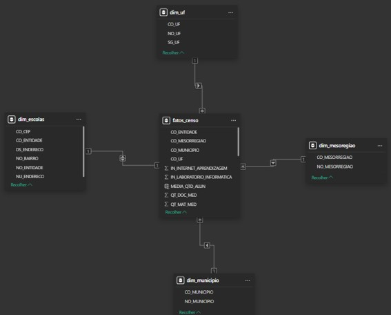

# Análise de Infraestrutura do Ensino Médio - Santa Catarina (Censo Escolar 2024)

## 📌 Objetivo do Projeto
O objetivo deste trabalho é utilizar dados educacionais para refletir as infraestruturas e medidas quantitativas das escolas do estado de Santa Catarina, com foco exclusivo no Ensino Médio[cite: 7]. O projeto demonstra um pipeline completo de análise de dados, desde a extração e modelagem em banco de dados relacional até a visualização interativa.

## 📊 Fonte de Dados
A base principal utilizada foi o **Censo Escolar de 2024**, divulgado e disponibilizado pelo INEP (Instituto Nacional de Estudos e Pesquisas Educacionais)[cite: 7].

## ⚙️ Arquitetura e Modelagem de Dados
O tratamento dos dados brutos em formato CSV foi realizado em ambiente SQL Server[cite: 7]. Para otimizar a performance no Power BI, foi construída uma modelagem dimensional no formato **Star Schema** (Esquema Estrela)[cite: 7].

O modelo é composto por:
* **Tabela Fato (`fatos_censo`):** Centraliza as métricas quantitativas, como matrículas (`QT_MAT_MED`), número de docentes (`QT_DOC_MED`), turmas (`QT_TUR_MED`) e indicadores de infraestrutura (internet, climatização, laboratórios)[cite: 7].
* **Tabelas Dimensão:**
  * `dim_escolas`: Contém detalhes de endereço, bairro, CEP e nome das entidades[cite: 7].
  * `dim_municipio` e `dim_uf`: Dados geográficos e códigos de municípios[cite: 7].
  * `dim_mesoregiao`: Nomes e códigos das mesorregiões de Santa Catarina[cite: 7].

*(Insira aqui a Imagem 6 do seu esquema estrela)*
`´

## 📈 Dashboard e Principais Métricas (DAX)
O painel gerencial foi desenvolvido no Power BI e permite a filtragem dinâmica por **Região do estado** (ex: Norte Catarinense) e **Tipo de Rede Escolar** (Municipal, Estadual, Federal e Privada)[cite: 7].

*(Insira aqui a Imagem 8 do seu dashboard final)*
``

**Principais medidas criadas utilizando linguagem DAX:**
* Percentual e contagem de escolas com/sem Salas Climatizadas[cite: 7].
* Percentual e contagem de escolas com/sem Internet para processos de ensino[cite: 7].
* Percentual e contagem de escolas com/sem Laboratório de Informática[cite: 7].
* Quantitativo total de alunos matriculados, professores e turmas no Ensino Médio[cite: 7].
* Média de alunos por turma[cite: 7].

Exemplo de lógica DAX utilizada para calcular o percentual de adequação estrutural:
```dax
% Escolas Climatizadas = 
 DIVIDE(
    [Escolas com Climatizacao],
    [Total Escolas],
    0
    )
